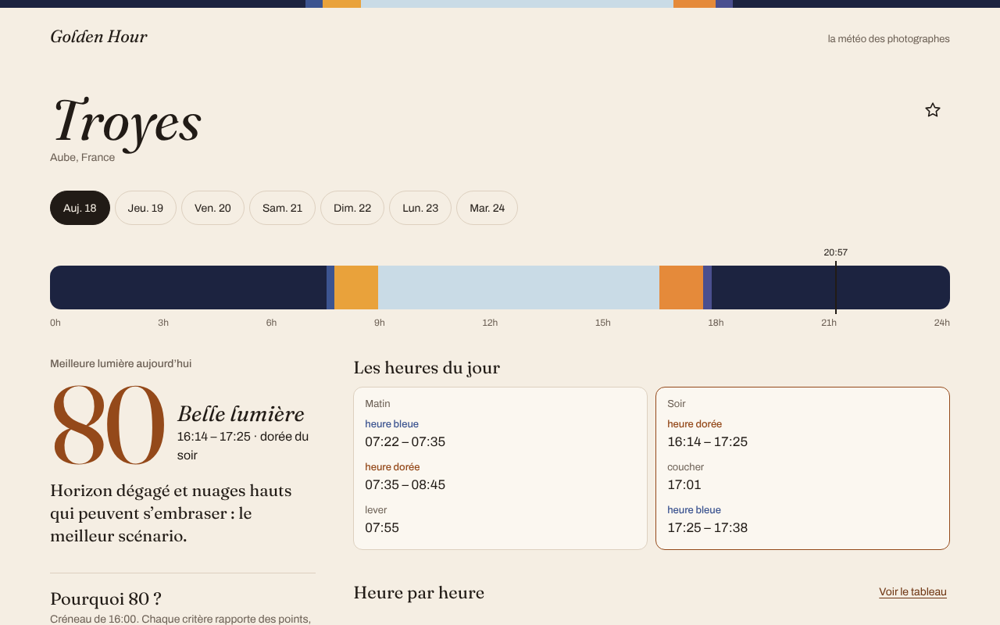

# Golden Hour
 
**La météo des photographes.** Golden Hour dit quand sortir faire des photos : heures dorées, heures bleues, couverture nuageuse heure par heure, et un score « bonne lumière » expliqué ligne par ligne.
 

 
## Fonctionnalités
 
- Recherche d’un lieu par son nom, avec filtre par pays ou région (« Troyes, Landes »)
- « Autour de moi » avec la géolocalisation du navigateur
- Pour chaque lieu, sur 7 jours :
  - heures bleues, heures dorées, lever et coucher du soleil
  - une bande « ciel » qui montre toute la journée d’un coup d’œil
  - un score de lumière sur 100 pour le meilleur créneau, avec le détail des points
  - un graphique heure par heure (nuages bas, nuages au total, risque de pluie, score), avec sa version tableau
- Lieux favoris enregistrés dans le navigateur, avec leur score du jour sur l’accueil
- Pages par lieu avec une URL propre : `/lieu/troyes-2971549`
- PWA installable, consultable hors ligne pour les pages déjà visitées
## Stack
 
| Outil | Rôle |
| --- | --- |
| Nuxt 4 / Vue 3 | Rendu serveur, routage, récupération des données |
| TypeScript strict | Typage des réponses de l’API et des calculs |
| SCSS | Styles, sans framework CSS |
| [Open-Meteo](https://open-meteo.com/) | Prévisions et géocodage, gratuits et sans clé |
| @vite-pwa/nuxt | Manifest et service worker |
| Fontsource | Polices Fraunces et Archivo hébergées avec le site |
 
## Choix techniques
 
**Rendu serveur ou site statique, au choix du déploiement.** Le code est pensé pour le rendu serveur : avec un serveur Node, `/lieu/troyes-2971549` arrive déjà rempli (titre, description, score dans le HTML), et les données passent au client sans second appel (`useAsyncData`). La version en ligne est hébergée sur un serveur Apache sans Node, qui n’autorise pas les règles de réécriture : elle est donc construite en application client avec des adresses en `#` (`/#/lieu/troyes-2971549`), activées par une simple variable au build. Le même code fonctionne dans les deux modes.
 
**L’identifiant dans l’URL.** Il existe deux Troyes en France, et des dizaines de Saint-Denis. Le nom rend l’URL lisible, l’identifiant Open-Meteo la rend unique. Une URL au mauvais nom redirige vers la bonne (301).
 
**Heures dorées et bleues calculées dans l’app.** Open-Meteo ne fournit que le lever et le coucher du soleil. `app/utils/sun.ts` calcule la hauteur du soleil (algorithme astronomique classique, sans dépendance) :
 
- heure bleue : soleil entre −6° et −4°
- heure dorée : soleil entre −4° et +6°
Les cas polaires (soleil de minuit, nuit polaire) sont gérés.
 
**Un score lisible plutôt qu’opaque.** `app/utils/score.ts` additionne des points, et chaque ligne est affichée :
 
| Critère | Points max | Logique |
| --- | --- | --- |
| Lumière | 45 | Heure dorée 45, heure bleue 25, plein jour 8, nuit 0 |
| Nuages bas | 25 | Ils bouchent l’horizon : moins il y en a, mieux c’est |
| Nuages hauts et moyens | 15 | Idéal entre 25 et 60 % : ils prennent la couleur du coucher |
| Pluie | 10 | Selon la probabilité, 0 s’il pleut |
| Visibilité | 5 | Maximum à partir de 20 km |
 
Les critères météo sont pondérés par la qualité de la lumière : un ciel parfait à midi reste un mauvais créneau.
 
**Pas de Pinia.** L’état partagé se limite aux favoris : un composable avec `useState` et le `localStorage` suffit. Ajouter un store n’aurait rien apporté.
 
**Cache à deux niveaux.**
 
- Côté serveur et navigateur, les prévisions sont gardées 15 minutes en mémoire (`useForecast`), donc aucun appel inutile à l’API en naviguant.
- Le service worker garde les dernières réponses et pages 24 heures pour le hors-ligne.
**Recherche en formulaire classique.** La recherche est un vrai formulaire `GET /recherche?q=` rendu côté serveur. Elle fonctionne au clavier, sans JavaScript, et l’URL des résultats se partage.
 
**Graphique en SVG fait main.** Pas de bibliothèque de graphiques : le SVG est léger, s’adapte à la largeur sans grossir le texte, et il a une alternative en tableau pour les lecteurs d’écran.
 
## Accessibilité
 
- Navigation complète au clavier : lien d’évitement, onglets des jours aux flèches, focus visible
- Textes alternatifs pour la bande du ciel et le graphique, tableau de données équivalent
- Contrastes AA (4,5:1 minimum) sur tous les textes
- Les couleurs du ciel ne portent jamais seules l’information : horaires et libellés en texte
- `prefers-reduced-motion` respecté
- Pages vérifiées avec axe-core, sans erreur
## Structure
 
```
app/
├─ components/   SkyBand, LightScore, ScoreExplain, HourlyChart, DayTabs…
├─ composables/  useForecast, usePlaces, useFavorites, useGeolocation, useOnline
├─ utils/        sun.ts, score.ts, forecast.ts, format.ts, slug.ts, api.ts
├─ types/        réponses Open-Meteo et modèle de l’app
├─ pages/        accueil, recherche, lieu/[slug], position
├─ plugins/      chargement des favoris côté client
└─ assets/scss/  variables, base, boutons, accessibilité
```
 
## Lancer le projet
 
Node 22.22 (ou 24.15 et plus) est nécessaire, comme pour Nuxt 4.6.
 
```bash
npm install
npm run dev
```
 
```bash
npm run typecheck
npm run build
npm run preview
```
 
## Mise en ligne
 
### Hébergement statique sans réécriture (version en ligne)
 
Pour un serveur Apache sans Node ni `.htaccess`, l’app étant servie sous `/mes_projet/golden-hour/` :
 
```bash
NUXT_HASH_ROUTER=1 NUXT_APP_BASE_URL=/mes_projet/golden-hour/ npm run generate
```
 
Envoyer ensuite le **contenu** de `.output/public/` dans le dossier correspondant du site (par FTP par exemple). Les adresses prennent la forme `/mes_projet/golden-hour/#/lieu/troyes-2971549` : le serveur renvoie toujours `index.html` et le routeur lit la partie après le `#`. Pour un autre chemin, adapter `NUXT_APP_BASE_URL`.
 
### Serveur Node (rendu serveur)
 
Avec pm2 et l’app servie sous `/golden-hour/` :
 
```bash
npm ci
NUXT_APP_BASE_URL=/golden-hour/ npm run build
npx pm2 start ecosystem.config.cjs
npx pm2 save
```
 
Le serveur web transmet ensuite `/golden-hour/` au port 3010. Avec Apache (modules `proxy` et `proxy_http`) :
 
```apache
<Location /golden-hour/>
    ProxyPass http://127.0.0.1:3010/golden-hour/
    ProxyPassReverse http://127.0.0.1:3010/golden-hour/
</Location>
```
 
Dans les deux cas, la géolocalisation et le service worker demandent du HTTPS.
 
## Limites connues
 
- Open-Meteo ne fait pas de géocodage inverse : « Autour de moi » affiche des coordonnées, pas un nom de ville.
- Le score est une heuristique de photographe, pas une vérité météo : un ciel couvert peut offrir une belle lumière douce.
- Les heures calculées peuvent différer d’une à deux minutes des éphémérides officielles.
## Crédits
 
Données météo et géocodage : [Open-Meteo](https://open-meteo.com/), licence CC BY 4.0.
 
Conception et développement : [Eva Mignerey](https://eva-mignerey.fr).
 